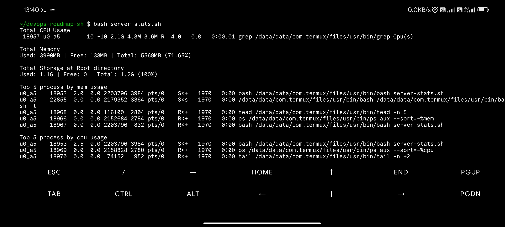

# devops-roadmap-sh
Hands-on practice repo for the [DevOps roadmap](https://roadmap.sh/devops) on roadmap.sh website.

## Goal
Learn by doing: break things, fix them, write down what I learned.

## Current Device 
My Redmi Note 10 Pro coz my laptop screen along with it's frame and bezel gave up and I'm broke and unemployed 🥲 thanks to **termux** btw to keep me going. (⁠•⁠‿⁠•⁠)

## Screenshots 
here're the screenshots of my script's output
|[server-stats](https://roadmap.sh/projects/server-stats)|
|:---:|

